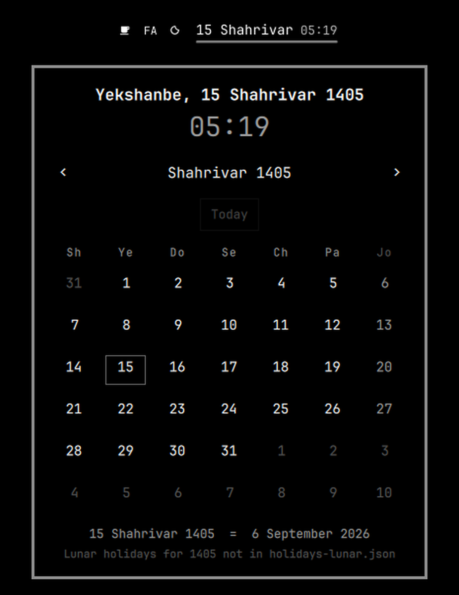

# Jalali Calendar

An [Omarchy](https://omarchy.org/) shell plugin: the Jalali (Solar Hijri /
Shamsi) date and a 24-hour clock in your bar, and a month calendar in the
panel behind it. Month and weekday names are romanized — `Ordibehesht`, not
`اردیبهشت` — and the numerals are Latin throughout.



## Features

- **Bar widget** — day number and Finglish month with the time beside it,
  e.g. `13 Shahrivar 14:32`. Rolls over at local midnight on its own.
- **Live 24-hour clock** — `HH:mm`, no AM/PM, on the bar and again in the
  panel. It ticks on the minute whether or not the panel has been opened, and
  reads the system clock in local time, so a timezone change follows the
  machine with nothing to configure. On a vertical bar the hour and the
  minute stack under the date.
- **Panel** — a month grid behind one click, with the full date in Finglish
  above it and the clock under that: `Jome, 13 Shahrivar 1405` over `14:32`.
- **Saturday-first grid** on the Iranian week — `Shanbe, Yekshanbe, Doshanbe,
  Seshanbe, Chaharshanbe, Panjshanbe, Jome` — always six rows, so the panel
  never changes height as you step through months.
- **Finglish throughout.** Persian month, weekday and holiday names in Latin
  script, with Western numerals.
- **Official Iranian holidays** in red with a dot under the number, so they
  still read as holidays on a theme whose palette has no real red. The ten
  fixed solar holidays ship complete; lunar ones are a data file you fill in
  (see [Holidays](#holidays)).
- **Gregorian equivalent** of whatever day you point at, on a steady line
  under the grid — `18 Shahrivar 1405 = 9 September 2026`.
- **Keyboard navigation** with a visible day cursor that turns the page at
  month edges.
- **Theme-adaptive.** Every colour comes from the active Omarchy theme, so the
  panel re-skins on `omarchy theme set` with nothing to configure. Verified on
  both light and dark themes.
- **Correct leap years.** Esfand is 30 days in a leap year and 29 otherwise,
  and stepping across a Nowruz boundary lands where it should.

## Requirements

- Omarchy 4 ("Quattro") or newer — the Quickshell-based `omarchy-shell`.

Built and tested on Omarchy 4.0.2 (Quickshell 0.3.1, Qt 6.11). No network
access, no external fonts, no dependencies.

## Install

```bash
omarchy plugin add https://github.com/mahziyarng98/jalali-calendar.git --enable
```

Plugins land disabled by default so you can read the code first; `--enable`
skips that and puts the widget into the bar's centre section. Move it with:

```bash
omarchy bar move io.github.mahziyarng98.jalali-calendar --section right
```

## Update

```bash
omarchy plugin update io.github.mahziyarng98.jalali-calendar
```

Fetches, shows a diff of the incoming changes, then fast-forwards.
`omarchy plugin update` with no argument updates every git-managed plugin.

## Remove

```bash
omarchy plugin remove io.github.mahziyarng98.jalali-calendar
```

To take it off the bar without uninstalling it:

```bash
omarchy plugin disable io.github.mahziyarng98.jalali-calendar
```

## Replacing the built-in clock

Installing this plugin **adds** a widget; Omarchy's own Gregorian clock stays
in the bar alongside it. Since this widget tells the time too, what the
built-in clock still adds is the Gregorian date — so running both is a choice
rather than the default it looks like. Two independent settings control what
you end up with, and you may want either, both, or neither.

Everything below edits `~/.config/omarchy/shell.json` — **your own settings
file**, not plugin or shell source. That matters: it survives `omarchy update`,
whereas edits to files under `/usr/share/omarchy/` are overwritten on every
update. `shell.json` hot-reloads, so no restart is needed.

**Pin this widget to the exact centre of the bar.** `centerAnchor` names the
one centre module that sits dead centre, with the others flanking it:

```json
{
  "version": 1,
  "bar": {
    "centerAnchor": "io.github.mahziyarng98.jalali-calendar",
    "layout": {
      "center": [
        { "id": "io.github.mahziyarng98.jalali-calendar" }
      ]
    }
  }
}
```

**Hide the Gregorian clock.** `centerAnchor` only decides placement — on its
own it does not remove anything. If you want the Jalali date *instead of* the
built-in clock rather than beside it, disable the clock as well:

```bash
omarchy plugin disable omarchy.clock
```

That drops it from the bar layout and leaves the component available, so
`omarchy plugin enable omarchy.clock` brings it back.

Both steps are optional. Skip them to keep both calendars visible side by
side — a Gregorian clock and a Jalali date is a reasonable thing to want.

## Using it

| Where | Action | Result |
|---|---|---|
| Bar | left click | open / close the panel |
| Panel | `‹` `›` or scroll wheel | previous / next month |
| Panel | click a day | pin it to the line under the grid |
| Panel | hover a holiday | its name, in Finglish |
| Panel | `Today`, or click the header date | back to the current month |

### Keyboard

The panel takes keyboard focus when it opens.

| Key | Action |
|---|---|
| `←` `→` / `h` `l` | move the day cursor one day, turning the page at a month edge |
| `↑` `↓` / `k` `j` | move the day cursor one week |
| `[` `]` | previous / next month |
| `{` `}` | previous / next year |
| `t` | back to today |
| `Enter` / `Space` | back to today |
| `Tab` / `Shift-Tab` | move to the next / previous bar panel |
| `Esc` | close |

### IPC

For a Hyprland keybinding, or any script:

```bash
omarchy-shell jalali-calendar toggle
omarchy-shell jalali-calendar open
omarchy-shell jalali-calendar close
omarchy-shell jalali-calendar refresh
```

The IPC target is `jalali-calendar` — deliberately shorter than the plugin id,
so a keybinding stays readable.

## Configuration

Settings live inline on the widget's entry in `~/.config/omarchy/shell.json`
and hot-reload on save:

```json
{ "id": "io.github.mahziyarng98.jalali-calendar", "showYear": true, "showWeekday": false }
```

| Key | Default | Effect |
|---|---|---|
| `showYear` | `false` | append the year — `13 Shahrivar 1405` |
| `showWeekday` | `false` | prefix the weekday — `Jome, 13 Shahrivar` |

## Holidays

**Solar holidays ship complete** in `holidays-fixed.js`. These are fixed dates
on the Jalali calendar, so they never drift and never need maintenance:

| Date | Occasion |
|---|---|
| 1–4 Farvardin | Nowruz |
| 12 Farvardin | Islamic Republic Day |
| 13 Farvardin | Sizdah Be-dar |
| 14 Khordad | Demise of Imam Khomeini |
| 15 Khordad | 15 Khordad Uprising |
| 22 Bahman | Islamic Revolution Victory |
| 29 Esfand | Oil Industry Nationalization Day |

**`holidays-lunar.json` ships empty, on purpose.** Eyd-e Fetr, Eyd-e Ghorban,
Tasua, Ashura, Arbaeen, Eyd-e Ghadir and the rest follow the Hijri Qamari
calendar. They move about eleven days earlier each Jalali year and their exact
dates depend on the official crescent sighting, so they cannot be computed —
they have to be transcribed, per year, from an authoritative calendar.

Second-hand sources disagree with each other often enough that shipping a
guess would be worse than shipping nothing: a wrong Ashura is worse than a
visibly missing one. So the panel says so instead. While a year has no data it
prints `Lunar holidays for 1405 not in holidays-lunar.json` under the grid, so
an empty Moharram reads as missing data rather than as a month with nothing
in it.

### Filling it in

Read the official dates off an Iranian calendar for the year — the
[Institute of Geophysics, University of Tehran](https://calendar.ut.ac.ir/)
sets the approved one — and add them under `years`:

```json
"years": {
  "1405": [
    { "month": 3, "day": 6,  "name": "Eyd-e Ghorban" },
    { "month": 3, "day": 14, "name": "Eyd-e Ghadir" }
  ]
}
```

`null` means "not filled in yet" and triggers the notice; `[]` means "checked,
this year has none". The file is watched, so saving it updates an open panel
with no restart.

Worth checking before you trust a transcription: each holiday should land
about 10–11 days *earlier* in the Jalali year than it did the year before — a
jump of roughly a month means a month name was misread, which is the most
common error. Eyd-e Ghadir is 8 days after Eyd-e Ghorban; Arbaeen is exactly
40 days after Ashura; Tasua is the day before Ashura. The bundled converter
will check where a date lands:

```bash
node test/jalali-date-test.js 1405 3 6
# Chaharshanbe, 6 Khordad 1405  =  27 May 2026
```

Pull requests adding a verified year are welcome — please say in the PR which
calendar you took the dates from.

## Development

```bash
node test/jalali-date-test.js   # verifies the conversion against known dates
omarchy plugin validate .       # checks the manifest the way the shell does
```

The date math in `JalaliDate.js` is deliberately Qt-free so the same file runs
under node and inside QML. The tests round-trip every day of Jalali years
1300–1500 — 73,414 of them — and check the Nowruz anchors for 1400–1408, the
33-year leap cycle, and the weekday alignment against dates that can be
verified independently.

Editing a plugin's **entry point** (`BarWidget.qml`) hot-reloads on save.
Editing a file it pulls in behind a `Loader` — `Panel.qml` here — does not
reliably take, so apply those with `omarchy restart shell`.

### Files

| File | What it is |
|---|---|
| `manifest.json` | plugin declaration and the bar-widget settings schema |
| `BarWidget.qml` | the bar label, and the host for the panel |
| `Panel.qml` | the calendar panel |
| `JalaliDate.js` | Gregorian ↔ Jalali conversion, name tables, grid builder, clock labels |
| `holidays-fixed.js` | the ten fixed solar holidays |
| `holidays-lunar.json` | per-year lunar holidays — hand-maintained, see above |
| `test/jalali-date-test.js` | conversion checks, and a date-conversion CLI |

## How the dates are computed

Gregorian ↔ Julian Day Number uses Fliegel and Van Flandern's closed form. The
Jalali leap rule is Borkowski's: the year is astronomical rather than cyclic,
so its leap years are described by a table of breaks — years at which the
spacing changes — with leap years every 4 years inside a break interval and an
8-per-33 correction. Both are implemented from their published mathematical
descriptions rather than ported from an existing library.

## License

[MIT](LICENSE) © mahziyarng98
